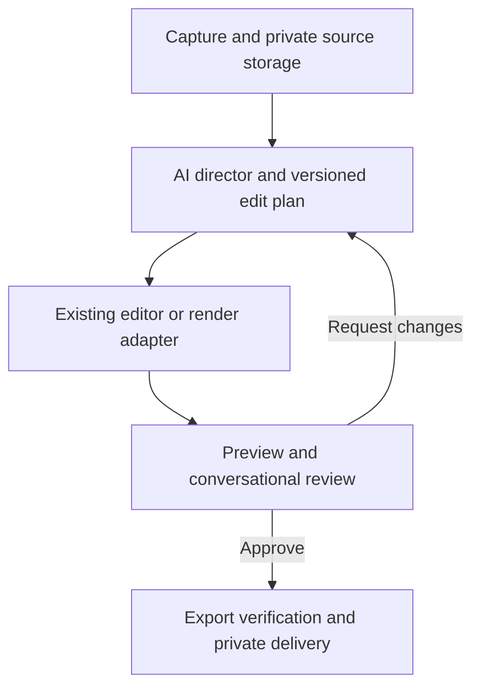

# AI Studio in a Book Bag — build versus rent

Research checked November 18, 2026. This is a provider evaluation and proposed
architecture, not a claim of tested Descript, Shotstack or Resolve integration.
No subscription, connector, provider account, deployment or paid resource was
created. No new editing application was built.

## Recommendation

Pilot **Descript's official MCP/API** first for the conversational director and
visible editing workspace. Keep Creator Automations as the project owner,
permissions/approval system and delivery coordinator. Keep the existing Groq/local
Whisper adapter and FFmpeg path for simple, repeatable clip work and fallback.
Evaluate **Shotstack** next if deterministic, branded volume exports and an editor
inside our platform matter more than a native conversational editing application.
Use **DaVinci Resolve Studio** for workstation-based finishing, difficult audio,
color and multi-camera work; do not make it the initial cloud backend.

This recommendation follows current official documentation: Descript now offers
both API-driven agent edits and MCP, rather than requiring screen clicking. None
of the three providers has been performance- or quality-tested in our account.
Do not purchase all three or build substitutes for their timeline interfaces.

## What agents can actually control

| Requirement | Descript | Shotstack | DaVinci Resolve |
|---|---|---|---|
| Projects and source import | Documented API import; URL or signed direct upload; async status | Edit JSON referencing authorized assets; ingestion and templates | Desktop project/media workflow through scripting; validate installed SDK |
| Cut and rearrange | Prompt Underlord via agent endpoint; follow-up conversation ID | Explicit source trim, clip start/length and ordered tracks | Timeline automation through version-specific Python/Lua scripting |
| B-roll | Agent-assisted edits and stock features; validate search/insertion behavior in pilot | Add supplied assets or separately priced generated media | Import authorized assets; stock discovery is a separate workflow |
| Multi-camera | Auto Multicam exists in the app; API/agent coverage is **not yet verified** | Can lay out cameras with provided offsets; don't assume automatic synchronization | Native multicam workflow; exact script exposure needs installed-version tests |
| Captions, music, transitions | Documented agent edit path; test precise styles, timing and licensed asset use | Schema-driven assets/tracks/transitions and caption overlays | Native tools plus scripting where exposed; some controls may need UI |
| Preview and conversational changes | Open actual Descript project; async edit jobs and follow-ups | Official MCP/Studio preview, JSON edits and cloud render | Open running desktop application through a local bridge |
| Undo | No dedicated undo endpoint found in reviewed API; checkpoint/restore needs pilot verification | Keep immutable prior Edit JSON and render the earlier revision | Native undo exists; don't promise arbitrary remote undo via scripting |
| Finished output | Publish job returns share URL and expiring download URL | Render status returns output URL; copy deliverable to owned storage | Render queue/export on the editing workstation |

Descript's publish operation can create a share page. Verify privacy/access before
using it with private client footage; do not silently publish a private project.
A download URL is not a permanently hosted MP4 attachment. Copy approved exports
into controlled delivery storage before the signed link expires. Serialise edits
within each project and wait for a job to finish before the next mutation.

“Watch it edit” should initially mean see job progress, open the native editing
workspace and review checkpoints. Continuous screen streaming or every-frame live
updates have not been demonstrated. None of these tools guarantees good editorial
judgment or correct captions from an instruction alone.

## Cost and volume

Prices are published USD figures, excluding taxes and our existing infrastructure.
They are not account quotes or charges incurred in this task.

| Option | Published entry/plan examples | Implication |
|---|---|---|
| Groq Whisper turbo | $0.04 per audio hour | Roughly $0.0394 for this 58:57 source including six seconds of chunk context; four requests; estimate only |
| Descript Hobbyist | $24 monthly; $16/month equivalent annually; 10 media hours, 400 AI credits | Low-volume 1080p pilot, not a 100-clips/day entitlement |
| Descript Creator | $35 monthly; $24/month equivalent annually; 30 media hours, 800 AI credits | Better pilot tier; top-ups and credit usage must be measured |
| Descript Business | $65 monthly; $50/month equivalent annually; 40 media hours, 1500 AI credits | Still far below 440 full-podcast source hours/month without top-ups or a volume agreement |
| Shotstack pay-as-you-go | $10 for 50 render minutes | 20 cents/output minute; roughly 15 cents per 45-second final render, excluding other services |
| Shotstack Scale | $199/month, 2000 render minutes | 100 clips/day × 45 seconds × 22 days = 1650 final minutes; a 20% render-revision allowance makes 1980 minutes |
| Resolve Studio | $295 list; official US page displayed $236 promotion when checked | Workstation, GPU, storage and operator time are additional; no cloud-render capacity included |

At 100 clips/day, one-hour inputs yielding five clips mean **440 source hours**
per 22-day month. Descript's sticker price does not cover that amount. API access
has no separate fee for paying users but consumes plan media minutes and AI
credits. A real volume quote/top-up measurement is needed; we cannot calculate an
honest all-in Descript cost per clip from a subscription price alone.

There is a useful hybrid to test: use Groq/our source index to select moments and
send only approved excerpts to the editing provider. At 100 × 45 seconds/day, that
is 27.5 media hours/month before revisions, rather than 440 full-source hours.
Creator's 30-hour allowance leaves little revision headroom; Business's 40-hour
allowance leaves more. AI credit consumption remains unknown. Asking about footage
outside those excerpts requires importing more media or sending a replacement
excerpt. Descript imports also perform their own transcription; do not assume an
external Groq transcript bypasses those minutes or the second transcription.

Shotstack bills output duration separately from generated-media costs. Previews,
repeat final renders, storage and bandwidth can add usage. Scale includes only
30 GB each of hosting and monthly bandwidth; archive/deliver through our storage
and price overages rather than treating the render plan as unlimited delivery.
A 60-second average and 20% revision allowance would use 2640 minutes/month,
requiring top-ups. Its embedded editor is source-available under PolyForm Shield,
not an unrestricted MIT grant; check the intended embedding license before rollout.

Human time remains decisive. 20 orders × 15 minutes of review is five hours/day,
before intake, rendering and revisions. To do orders strictly one at a time in an
8-hour day with a 15% buffer, average full order time must be at most 20.4 minutes.
We have not demonstrated 100 approved clips/day or a human-inclusive 30-minute SLA.
At a hypothetical $25/hour, 15 review minutes per five-clip order costs $1.25 per
clip in labor alone. Software pricing should be compared with measured labor saved.

## The architecture to build around an existing editor

Build only the connective layer:

- Client/project IDs, brand presets, asset rights, source hashes and original
  timecodes. Keep clients' original media and metadata exportable.
- A director that turns speech/text into a proposed edit plan referencing source
  assets, source ranges, camera offsets, captions, audio levels and output format.
  Actual edits go through the chosen supported API; do not pretend all UI features
  are scriptable. An editing request is distinct from permission to publish or pay.
- Immutable plan revisions and engine project/composition IDs. Apply commands to
  a copy/checkpoint when supported; restore prior plans rather than asking an LLM
  to reconstruct the old edit. For unsupported engine undo, use native UI review
  until a reliable restore path is verified.
- Jobs with idempotency keys, bounded retries, stage timings and cost estimates.
  Prevent duplicate paid submissions after uncertain timeouts. Record result URLs,
  provider job IDs and schema versions. Validate callbacks and project ownership.
- Client approval and delivery retention policy. Raw media belongs in private
  object storage or an approved client folder; Render handles orchestration and a
  separate worker only. Store metadata in Postgres, no video bytes. No media in Git
  or the live backend's persistent disk. Retention is off until agreed, then apply
  storage lifecycle rules and revoke delivery URLs consistently.

Rent editor UI, complex multi-track editing, speaker reframing, specialized audio
cleanup, stock discovery and generation capabilities that pass a real pilot.
Thumbnails stay optional. Preserve Quick Clip and Full Package modes. A caption or
boundary revision should render only the affected composition/clip and reuse the
source transcript. Our HTTP test already verifies correction/export without ASR.

Use authorized music and B-roll. Generated video has a separate cost/latency
budget from clipping real footage. Do not enable face regeneration, eye-contact
alteration, voice cloning or synthetic artist performances by default. Resolve
would run on a suitable laptop/workstation; its desktop app and GPU requirements
are not supplied by our current Render backend. Any MCP bridge there must be
restricted to the local machine; community bridges are not official Blackmagic
connectors and have not been installed or audited here.

## Next milestones and acceptance criteria

1. **Finish live Groq verification.** Securely configure the key only in isolated
   development; authorize one capped whole-podcast request set (estimate about four
   cents, account conditions permitting). Measure upload/preprocessing/request
   time, selected names, word timestamps, seam errors and actual usage. Then run
   the existing five-export benchmark with the fresh Groq transcript. Stop on
   unexpected charges or auth/rate-limit errors. No production deployment.
2. **One Descript pilot, before more app development.** With approved account access
   and a small budget, import the licensed podcast or five selected excerpts; ask
   for five vertical clips; correct a name and change a start point; verify a
   checkpoint/undo; publish only this authorized public test source if approved;
   download 1080p exports. Record total elapsed time and both media/AI-credit usage.
3. **One Shotstack comparison if needed.** Use the same approved cutlist/captions,
   test the free watermarked stage with authorized account access, then compare a
   paid final only with approval. Check preview usability, template fidelity and
   revision time. Do not build an editor canvas before this decision.
4. **One real multi-camera order.** Supply two authorized camera files and audio;
   measure synchronization error and speaker framing. Choose native engine support
   before implementing waveform alignment ourselves. Demonstrate safe revisions.
5. **Production readiness, then scale.** Ten varied human-reviewed orders, then a
   20-order/100-clip shift with elapsed times, caption corrections, failure rates,
   retries, bandwidth, costs and reviewer hours. Acknowledge incomplete/poor clips
   rather than counting every render as an approved deliverable. Obtain separate
   approval for worker/storage resources and any deployment.

## Primary references

- Descript API and usage: https://www.descript.com/api
- Descript API contracts: https://dev-docs.descriptapi.com/
- Descript MCP and limitations: https://www.descript.com/mcp
- Descript prices: https://www.descript.com/pricing
- Shotstack agent flow: https://shotstack.io/docs/guide/agents/
- Shotstack MCP tools: https://shotstack.io/docs/guide/agents/mcp-server/
- Shotstack prices/licensing: https://shotstack.io/pricing/
- Resolve Studio: https://www.blackmagicdesign.com/products/davinciresolve/studio
- Resolve official feature matrix: https://documents.blackmagicdesign.com/SupportNotes/DaVinci_Resolve_Studio_21_Features.pdf
- Groq speech limits and prices: https://console.groq.com/docs/speech-to-text
